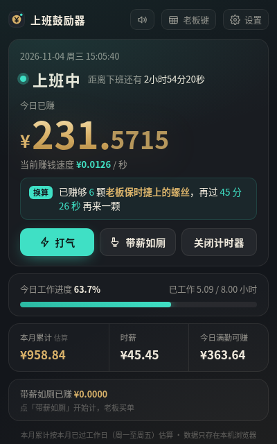
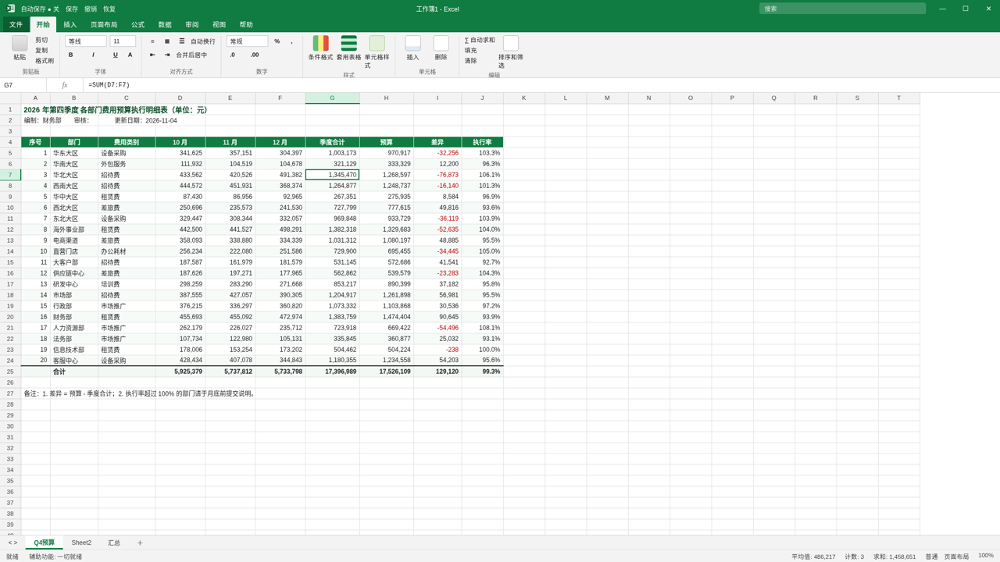

# 上班鼓励器

一个挂在屏幕角落、按秒数着你今天赚了多少钱的无厘头小窗：金币会掉，烟花会放，老板来了一键变 Excel。



## 怎么装

- **下载 ZIP**：在 GitHub 仓库页点 `Code` → `Download ZIP`，解压到任意位置。解压出的文件夹名会带 `-main`（例如 `lansike-shangban-guliqi-main`），这是正常的，不用改。
- **git clone**：
  ```bash
  git clone https://github.com/lansike/lansike-shangban-guliqi.git
  ```
- 不用安装任何东西，不需要 Node、Python，也不联网。
- 也可以让本地智能体（WorkBuddy、Claude、Cursor 等）直接帮你下载并打开。
- 豆包不支持本地运行。

## 怎么点

**打开**

- 双击 `index.html`：用默认浏览器打开（推荐 Chrome / Edge）。
- 双击 `start-mini.bat`（Windows）：用 Chrome 或 Edge 开一个 400×640 的小窗，可以拖到屏幕角落挂着；都没装时用默认浏览器打开。

**第一次用**

点右上角「设置」，填月薪、上下班时间、午休（午休不计薪）、每月工作日，点保存。默认是月薪 8000、09:00–18:00、午休 12:00–13:00、每月 22 天。设置只存在本机浏览器里。

**看什么**

- 今日已赚：小数点后 4 位实时滚动；下面是每秒赚多少、今日工作进度、本月累计（按本月已过的周一至周五估算）、时薪、今日满勤可赚。
- 「关闭计时器」：把数字冻住不看（钱照样在赚）。

**无厘头功能**

| 功能 | 怎么触发 |
| --- | --- |
| 掉金币 | 每赚满 ¥1 自动掉一枚并「叮」一声；到 ¥10 / 50 / 100 / 200 / 500… 放小烟花。浏览器规定要先点一下页面才能出声，右上角喇叭可关音效 |
| 换算轮播 | 自动轮换：奶茶、煎饼、半杯咖啡、老板保时捷上的一颗螺丝……「再过 x 分 y 秒就能买」或「已赚够」 |
| 带薪如厕 | 点「带薪如厕」开始计时，再点结束；单独累计「带薪如厕已赚」 |
| 老板键 | 按 `Esc` 或 `B`，或点「老板键」，立刻变成一张正经 Excel 表，标签页标题变「工作簿1 - Excel」；再按一次切回 |
| 加班模式 | 过了下班点金额变灰，显示「白干中，已为老板免费贡献 ¥x」 |
| 打气 | 点「打气」随机来一句鼓励（不重样地轮完再重来） |
| 下班倒数 | 下班前最后 10 秒满屏大字倒数，到点满屏烟花 +「下班！」 |
| 录屏模式 | 「设置」里可以 ×1 / ×60 / ×600 快进时间，一键跳到「下班前 15 秒」「快满 ¥100」「加班中」「午休中」；录屏模式不写入真实累计 |

**快捷键**

| 键 | 作用 |
| --- | --- |
| `Esc` / `B` | 老板键（假 Excel ⇄ 回来）；在假 Excel 里双击也能回来 |
| `J` | 打气 |
| `T` | 带薪如厕 开 / 关 |
| `M` | 音效 开 / 关 |
| `D` | 进入录屏模式 / 显示或隐藏录屏工具条 |


## Agent 怎么调

纯前端页面，没有接口、不接任何服务。Agent 想演示或录屏，带上网址参数打开即可。Windows 下用 `start-mini.bat` 带参数打开（文件夹名有中文或空格也行）：

```bat
:: 用小窗打开并直接跳到下班前 15 秒
start-mini.bat "demo=offwork"

:: 多个参数用 & 连接，整段加引号
start-mini.bat "demo=100&speed=60"
```

`start "" "index.html#demo=offwork"` 这种把参数直接拼在文件名后面的写法，Windows 会把整段当成文件名，打不开；请用上面的写法。

支持的参数（写在 `#` 后面，多个用 `&` 连接）：

| 参数 | 作用 |
| --- | --- |
| `demo=offwork` | 跳到下班前 15 秒（配合 `before=10` 改成 10 秒） |
| `demo=100` | 跳到今日已赚快满 ¥100 |
| `demo=overtime` | 跳到下班后 47 分钟（白干中） |
| `demo=lunch` | 跳到午休中 |
| `demo=morning` | 跳到上班前 5 分钟 |
| `demo=now` | 用当前时间进入录屏模式 |
| `speed=60` | 时间倍速（如 1 / 60 / 600），单独使用时以当前时间进入录屏模式 |
| `before=10` | 和 `demo=offwork` 一起用：下班前多少秒 |
| `boss=1` | 打开就是假 Excel |
| `pep=1` | 打开就弹一句打气 |
| `clean=1` | 隐藏录屏角标和工具条，适合录屏 |
| `mute=1` | 静音 |

周末打开录屏模式时，会借用最近的一个工作日来演示。页面上还挂了一个 `window.SBG` 对象（`jump`、`setSpeed`、`setBoss`、`pep`、`celebrate` 等），方便脚本驱动。

## 是否需要 Key

不需要。不联网、不登录、不收集任何数据；设置和带薪如厕累计只存在本机浏览器的 localStorage 里，清除浏览器数据就没了。



## License

MIT
